<div align="center">

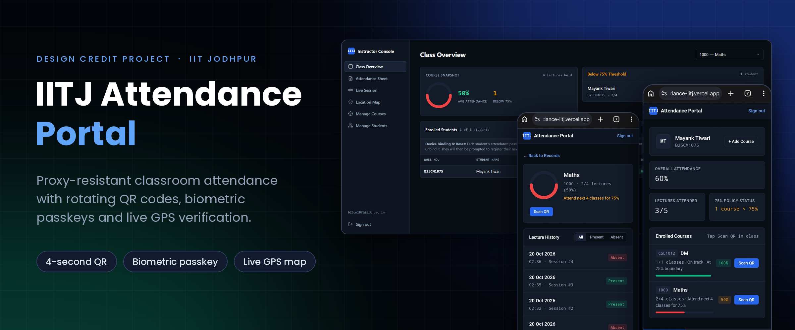

<br>

# IITJ Attendance Portal

**Classroom attendance that students can't fake. Rotating QR codes, hardware-bound biometric passkeys and live GPS, with no special hardware in the lecture hall.**

<p>
  <a href="https://attendance-iitj.vercel.app"></a>
  <a href="docs/IITJ_Attendance_Portal_Design_Credit_Report.pdf"></a>
</p>

<p>
  
  
  
  
  
  
  
</p>

<p>
  <a href="#at-a-glance">At a glance</a> ·
  <a href="#what-this-project-demonstrates">For recruiters</a> ·
  <a href="#screenshots">Screenshots</a> ·
  <a href="#how-it-works">How it works</a> ·
  <a href="#run-it-yourself">Run it yourself</a> ·
  <a href="#team">Team</a>
</p>

</div>

> [!NOTE]
> **Visiting from campus placements?** Sign-in is restricted to `@iitj.ac.in` Google accounts, so the live app can only be opened by IIT Jodhpur students and staff. Everything it does is shown in the [screenshots](#screenshots) below and in the [13-page design report](docs/IITJ_Attendance_Portal_Design_Credit_Report.pdf).

---

## At a glance

### The problem

At IIT Jodhpur, students must keep at least **75% attendance** in every course. Taking attendance on paper or by calling out names costs **10 to 15 minutes of every lecture**, and it is easy to cheat:

- a friend signs or answers for you,
- someone photographs a normal QR code and sends it to the hostel group chat,
- a student logs into a friend's account on a second phone, right inside the classroom.

### The solution

A web app with two sides, one for students and one for instructors. The instructor projects a QR code that **changes every 4 seconds**. Each student scans it with their own phone, confirms with the phone's **fingerprint or face unlock**, and the app records the **GPS location** of the check-in. A whole class can be marked in **under 30 seconds**, and none of the usual tricks work.

<table>
  <tr>
    <td align="center" width="25%"><h3>4</h3>independent verification layers</td>
    <td align="center" width="25%"><h3>6.5 s</h3>maximum life of any QR code</td>
    <td align="center" width="25%"><h3>&lt; 30 s</h3>to mark a full class</td>
    <td align="center" width="25%"><h3>0</h3>extra hardware needed</td>
  </tr>
  <tr>
    <td align="center"><h3>21</h3>API routes behind one serverless function</td>
    <td align="center"><h3>6</h3>normalised PostgreSQL tables</td>
    <td align="center"><h3>2</h3>role-based apps (student, instructor/TA)</td>
    <td align="center"><h3>0</h3>frontend build steps or frameworks</td>
  </tr>
</table>

### Privacy by design

There are no photos, no face recognition and no tracking. The fingerprint or face scan never leaves the student's phone, and the server stores only a public key. Location is read once, at the moment of check-in.

---

## What this project demonstrates

| Area | Evidence in this project |
| --- | --- |
| **Full-stack engineering** | Mobile-first student app and projector-friendly instructor console in plain HTML, CSS and ES2022 JavaScript, a Node.js serverless API, and a PostgreSQL database, deployed live on Vercel and Supabase. |
| **Security engineering** | HMAC-SHA256 signed QR tokens, W3C WebAuthn passkeys, replay protection through atomic challenge consumption, constant-time signature comparison, server-side domain enforcement, row-level security that denies all direct database access, and hardened HTTP headers. |
| **System design** | Stateless time-bucketed QR signing (no database write per rotation), a single API dispatcher for 21 routes, role-based access for instructors and TAs, and a documented three-tier architecture. |
| **Applied maths** | A grace-window analysis that separates honest scans (about 2 s) from relayed photos (10 s or more), a Haversine geofence, and a closed-form calculator that tells a student exactly how many classes they need to reach 75%. |
| **Database design** | Six normalised tables with cascading foreign keys and composite unique constraints that make double enrolment and double attendance impossible at the database level. |
| **Product thinking** | A guided recovery flow for blocked location permission, a live counter while the class checks in, one-click corrections for instructors, and spreadsheet-safe CSV export. |
| **Documentation and teamwork** | Built by a team of two under faculty supervision, with a full design report covering architecture, protocols, schema and API reference. |

### A two-minute tour of the code

| If you want to see... | Open |
| --- | --- |
| How the QR code is signed and validated | [`lib/attendance-options.js`](lib/attendance-options.js) and [`lib/config.js`](lib/config.js) |
| How a check-in is verified end to end | [`lib/mark-attendance.js`](lib/mark-attendance.js) |
| How a phone gets locked to one student | [`lib/register-options.js`](lib/register-options.js) and [`lib/register-verify.js`](lib/register-verify.js) |
| How the instructor's rotating QR is produced | [`lib/session-qr.js`](lib/session-qr.js) |
| The database schema and access rules | [`schema.sql`](schema.sql) |
| The student app | [`index.html`](index.html) and [`attendance.js`](attendance.js) |
| The instructor console | [`teacher.html`](teacher.html) and [`teacher.js`](teacher.js) |

---

## Why it can't be gamed

Every common way of faking attendance is blocked by a dedicated layer.

<div align="center">
  
</div>

| How students try to cheat | What stops it |
| --- | --- |
| Photograph the projected QR and forward it to friends in the hostel | The QR rotates every **4 seconds** and each code expires within **6.5 seconds**. Photographing, sending, downloading and scanning takes 10 seconds or more. |
| Sign into an absent friend's account on the same phone | Every account is bound to **its own phone's biometric sensor**. The server asks for a signature from that one registered credential, which does not exist on the friend's phone. |
| Move the passkey to a friend's phone just before class | The binding is **permanent**. Students cannot reset it themselves (the server answers HTTP 409). Only the instructor or a TA can unbind a device. |
| Join from the hostel or over a video call | A high-accuracy **GPS fix** is stored with every check-in, and any scan more than 3 km from campus is flagged on the instructor's map. |
| Use a fake or outside account | Google sign-in is limited to `@iitj.ac.in`, and **every API call re-checks it on the server**. |

<details>
<summary><b>How does this compare with other attendance methods?</b></summary>

<br>

| Method | Class time used | Stops QR photo sharing | Stops multi-account login on one phone | Verifies live location |
| --- | --- | :---: | :---: | :---: |
| Paper sheet or roll call | 10 to 15 minutes | ❌ | ❌ | ❌ |
| Static QR or Google Form | 1 to 2 minutes | ❌ | ❌ | ❌ |
| Wall-mounted biometric scanner | 10 to 20 minutes (queue at the door) | ✅ | ✅ | Fixed to the wall, costly per room |
| **IITJ Attendance Portal** | **Under 30 seconds** (everyone scans in parallel) | ✅ | ✅ | ✅ |

</details>

---

## Screenshots

### Student portal (mobile)

<table>
  <tr>
    <td align="center" width="25%">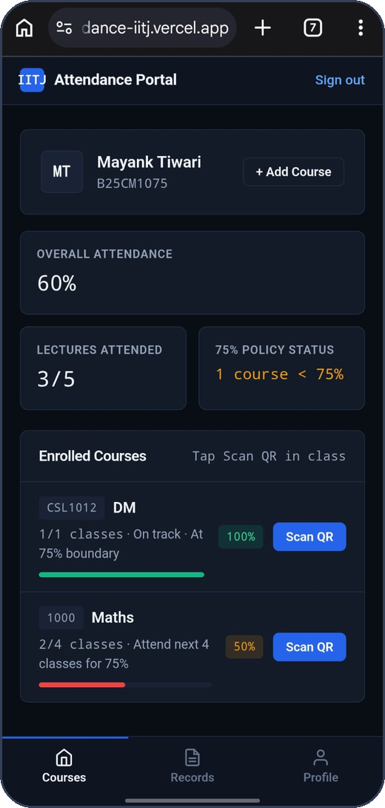<br><sub><b>Dashboard</b><br>Overall attendance, 75% policy status and one-tap <i>Scan QR</i> per course</sub></td>
    <td align="center" width="25%">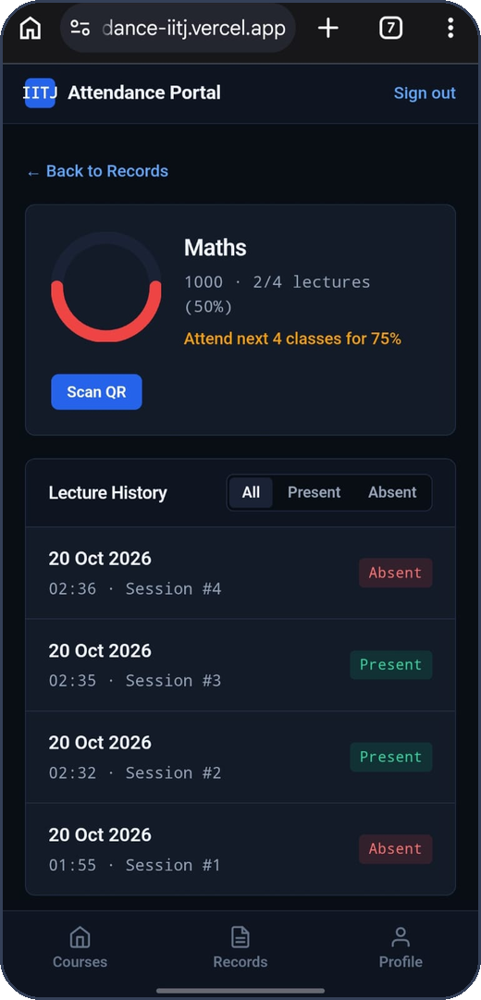<br><sub><b>Course detail</b><br>Attendance ring, "attend the next 4 classes for 75%" guidance and lecture history</sub></td>
    <td align="center" width="25%"><br><sub><b>Check-in</b><br>Scan, fingerprint, done</sub></td>
    <td align="center" width="25%">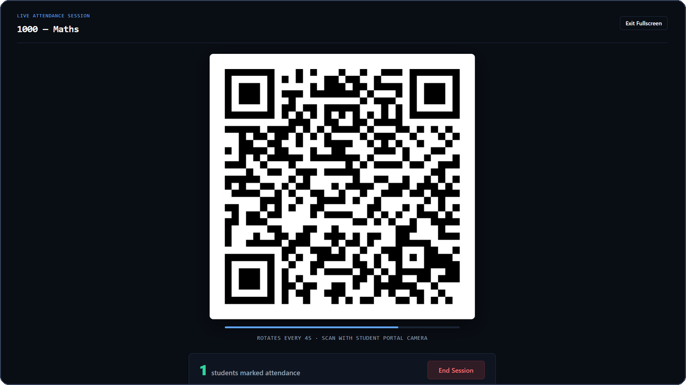<br><sub><b>Records</b><br>Every course at a glance against the 75% minimum</sub></td>
  </tr>
</table>

### Instructor console (desktop)

<table>
  <tr>
    <td width="50%" valign="top"><br><sub><b>Live session</b><br>Fullscreen QR for the projector, a countdown bar for each rotation and a live count of students checked in</sub></td>
    <td width="50%" valign="top">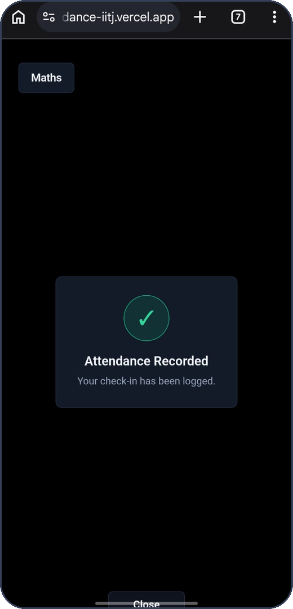<br><sub><b>Class overview</b><br>Average attendance, students below 75% and each student's device status</sub></td>
  </tr>
  <tr>
    <td width="50%" valign="top"><br><sub><b>Attendance sheet</b><br>Student-by-lecture matrix where one click toggles present or absent</sub></td>
    <td width="50%" valign="top">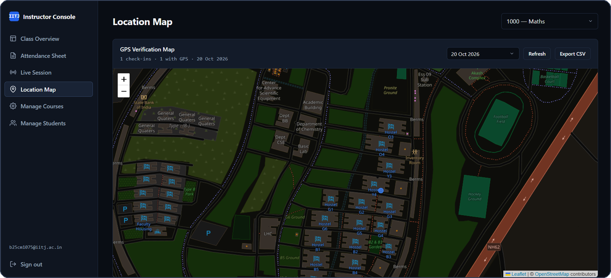<br><sub><b>Location map</b><br>Every check-in plotted on the IIT Jodhpur campus, with off-campus scans highlighted</sub></td>
  </tr>
  <tr>
    <td width="50%" valign="top">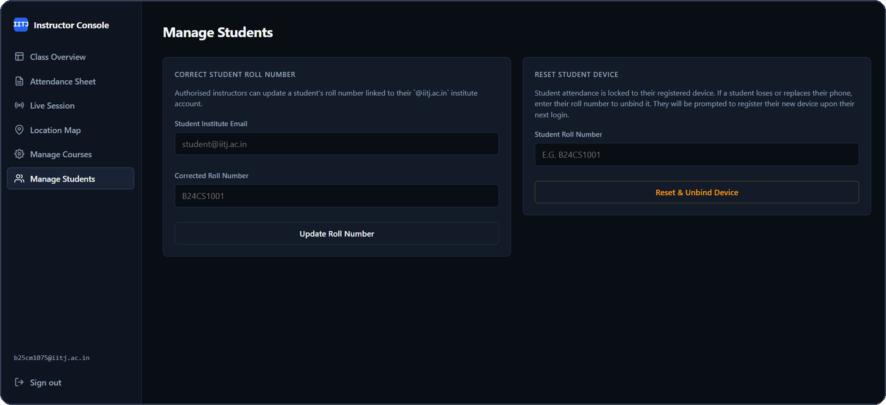<br><sub><b>Manage courses</b><br>Create courses and assign teaching assistants</sub></td>
    <td width="50%" valign="top"><br><sub><b>Manage students</b><br>Correct roll numbers and reset a student's device</sub></td>
  </tr>
</table>

---

## Features

**For students**

- Sign in with the institute Google account and register a phone once, using its own fingerprint or face unlock.
- Scan the classroom QR with the rear camera, with pinch-to-zoom for students at the back of the hall.
- Confirm with biometrics. Location is captured in parallel so the check-in stays quick.
- See attendance per course with a progress ring and a lecture-by-lecture history, filterable by *All*, *Present* or *Absent*.
- Get exact **75% policy guidance**, such as "Attend next 4 classes for 75%" or "On track, 3 class buffer".
- Edit their name later through a biometric-protected flow.
- If location access was blocked by mistake, follow a step-by-step recovery guide for Android Chrome or iOS Safari. The scanner restarts on its own once permission is granted.

**For instructors and TAs**

- Launch a live QR session in one click. Fullscreen mode is made for projectors, and sessions can be resumed after a page refresh.
- Watch the number of verified students rise in real time.
- Review the class on an overview dashboard that highlights anyone below 75%.
- Mark or unmark attendance for any lecture from an interactive matrix, or by roll number.
- Reset a student's bound device when they get a new phone, and correct roll numbers.
- Audit all check-ins on a campus map, with off-campus scans highlighted.
- Export attendance to CSV, protected against spreadsheet formula injection.
- Create and delete courses and assign TAs (instructors only).

---

## How it works

### A check-in in four steps

1. **The instructor starts a session.** The server creates a random 256-bit secret for that lecture.
2. **The screen shows a QR code** that is re-signed every 4 seconds with that secret.
3. **The student scans it.** The server checks the signature, the time window and the student's enrolment, then asks *that student's* phone to sign a one-time challenge.
4. **The student unlocks the phone** with a fingerprint or face. The server verifies the signature and the GPS fix, and records the attendance.

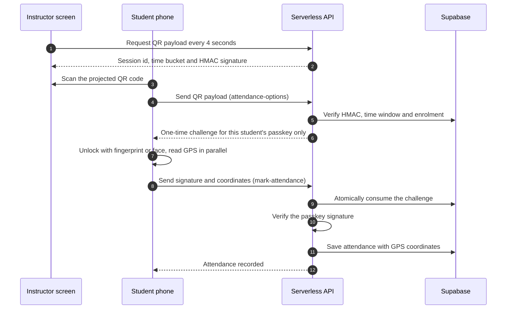

### System architecture

The portal is a lightweight, zero-install web app in three tiers: the browsers, a single Vercel serverless API, and Supabase for authentication and storage.

<div align="center">
  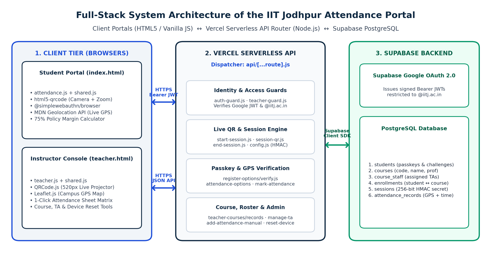
</div>

### Deep dives

<details>
<summary><b>Rotating QR codes: stateless HMAC time buckets</b></summary>

<br>

Writing a new random value to the database every 4 seconds would slow things down for a class of 200. Instead, the QR payload is derived from the current time and a per-session secret, so **nothing is written when the code rotates**.

```js
bucket  = Math.floor(Date.now() / 1000 / 4);
mac     = crypto.createHmac('sha256', Buffer.from(session_secret, 'hex'))
                .update(`${session_id}:${bucket}`).digest('hex').slice(0, 16);
payload = `${session_id}:${bucket}:${mac}`;
```

- The first 16 hex characters (64 bits) keep the QR small and easy to scan from the back row.
- The server accepts the current bucket and, for **2.5 more seconds**, the previous one. That makes the maximum life of a code 4.0 + 2.5 = **6.5 seconds**. Honest students on a slow network still succeed, while a photo relayed through a chat app does not.
- Signatures are compared with `crypto.timingSafeEqual`, so they can't be guessed through timing differences.
- The scanned course is checked against the selected course, so students are warned if they pick the wrong one.

<div align="center">
  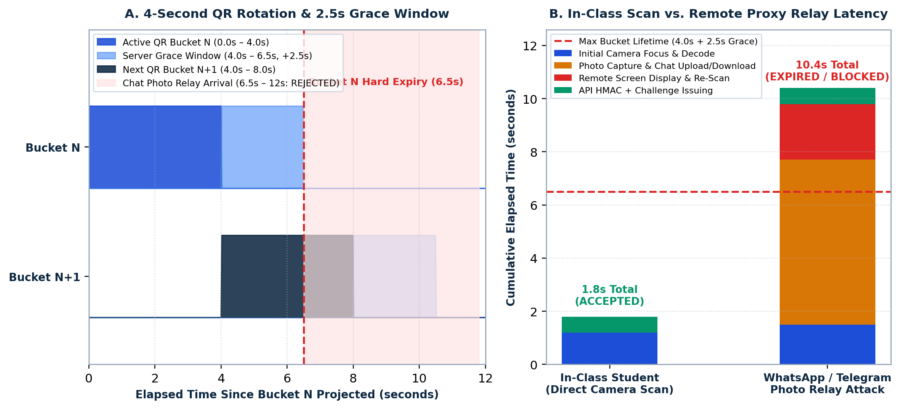
</div>

| Constant | Value | Purpose |
| --- | --- | --- |
| `ROTATION_SECONDS` | 4 s | How often the QR payload changes |
| `QR_GRACE_MS` | 2500 ms | How long the previous QR stays valid for scans already in flight |
| `FINGERPRINT_WINDOW_MS` | 30 000 ms | Time to finish the biometric step after a valid scan |
| `SESSION_MAX_MS` | 2 hours | Sessions close automatically |

</details>

<details>
<summary><b>Hardware-bound passkeys and replay protection</b></summary>

<br>

Rotating QR codes stop remote photo sharing. To stop **account sharing inside the classroom**, each roll number is locked to one phone using W3C WebAuthn (SimpleWebAuthn v14):

- `authenticatorAttachment: 'platform'` means the key must live in the phone's own secure hardware (Secure Enclave or Android Keystore). External keys and cross-device passkeys are rejected.
- `userVerification: 'required'` means the phone won't sign anything unless a fingerprint or face unlock succeeds.
- Once a device is registered, a second registration is refused (HTTP 409). Only an instructor or TA can reset the binding.
- During check-in the challenge is limited to the student's own credential (`allowCredentials`), tied to the exact QR that was scanned (`pending_qr_payload`), and valid for 30 seconds.
- Before the signature is verified, the challenge is **consumed atomically** with a compare-and-clear update. A captured response can never be replayed.

<div align="center">
  
</div>

</details>

<details>
<summary><b>Live GPS verification and campus geofence</b></summary>

<br>

- GPS capture starts at the same moment as the biometric prompt, so a high-accuracy fix is ready by the time the finger touches the sensor.
- The server accepts only finite coordinates in valid ranges, rounds them to 5 decimal places (about 1 m) and **blocks the check-in if location is missing**.
- On the instructor's map, the distance from the campus centre is computed with the Haversine formula. Scans within 3 km are blue, and anything farther is highlighted in amber with the student's roll number and distance.

```
a = sin²(Δφ / 2) + cos(φ₀) · cos(φ) · sin²(Δλ / 2)
d = 2 · R · atan2(√a, √(1 − a))        R = 6 371 000 m
```

- If a student taps "Never allow" on the browser's permission prompt, mobile browsers won't ask again. The portal detects the blocked state up front, shows platform-specific steps for Android Chrome or iOS Safari, and restarts the scanner automatically when permission is granted.

<div align="center">
  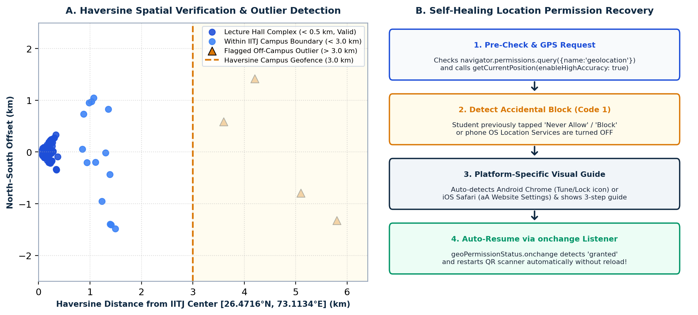
</div>

</details>

<details>
<summary><b>Database schema</b></summary>

<br>

Six tables on Supabase PostgreSQL. Foreign keys cascade, so deleting a course removes its sessions, enrolments and staff. `UNIQUE (student_id, course_id)` on enrolments and `UNIQUE (student_id, session_id)` on attendance records prevent duplicates at the database level.

<div align="center">
  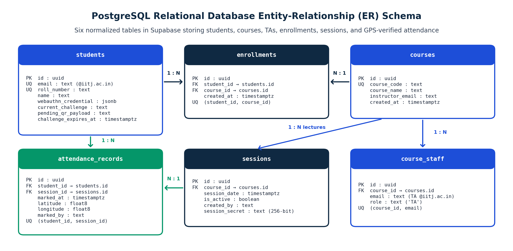
</div>

**Row-level security** is enabled on every table with restrictive deny-all policies. The public anon key shipped to the browser can't read or write anything. All real access goes through the API, which uses the server-only service-role key.

</details>

<details>
<summary><b>The 75% policy calculator</b></summary>

<br>

For `A` classes attended out of `T` held:

- Below 75%: attend `x = ⌈3T − 4A⌉` more classes in a row to reach 75%. For example, 2 of 4 lectures means the next **4** classes, because (2 + 4) / (4 + 4) = 75%.
- At or above 75%: the student can safely miss `y = ⌊(4A − 3T) / 3⌋` classes.

<div align="center">
  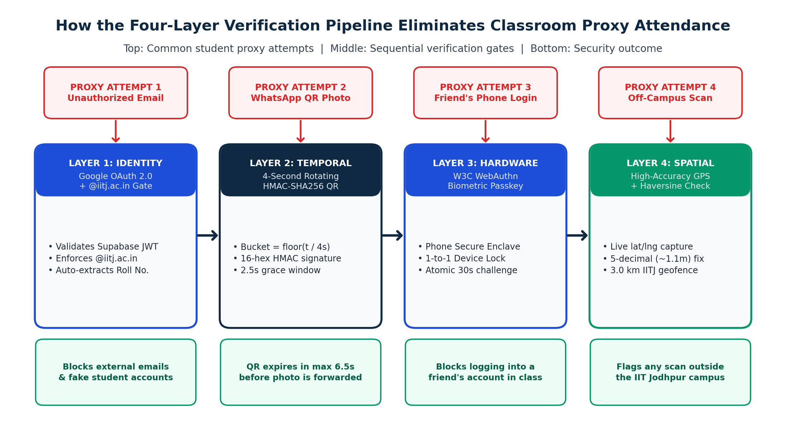
</div>

</details>

### Security checklist

| Control | Where |
| --- | --- |
| Google OAuth 2.0 only, `@iitj.ac.in` enforced **server-side** on every request | `lib/auth-guard.js` |
| HMAC-SHA256 QR signatures with constant-time comparison | `lib/attendance-options.js` |
| One-time, QR-bound, 30-second passkey challenge, consumed atomically | `lib/attendance-options.js`, `lib/mark-attendance.js` |
| Permanent 1-to-1 device lock, instructor-only reset | `lib/register-options.js`, `lib/teacher-reset-device.js` |
| Role checks for instructor and TA actions, per course | `lib/teacher-guard.js` |
| Short-lived (2 minute) biometric-gated token for profile edits | `lib/edit-auth-*.js`, `lib/update-profile.js` |
| Row-level security with deny-all policies | `schema.sql` |
| `X-Frame-Options`, `nosniff`, HSTS, `Referrer-Policy`, `Permissions-Policy` headers | `vercel.json` |
| CSV export escaped against formula injection | `teacher.js` |

---

## Tech stack

| Layer | Technology | Used for |
| --- | --- | --- |
| Frontend | HTML5, CSS3, vanilla ES2022 JavaScript (no framework, no build step) | Student portal and instructor console |
| Scanning | [html5-qrcode](https://github.com/mebjas/html5-qrcode) 2.3.8 | Rear-camera QR scanning with pinch-to-zoom |
| QR generation | [QRCode.js](https://github.com/davidshimjs/qrcodejs) 1.0.0 | Rotating projector QR |
| Biometrics | [SimpleWebAuthn](https://simplewebauthn.dev) 14 (W3C WebAuthn) | Passkey registration and verification |
| Maps | [Leaflet](https://leafletjs.com) 1.9.4 and OpenStreetMap | GPS verification map |
| API | Node.js serverless functions on Vercel, with a single catch-all router | 21 routes |
| Auth | Supabase Auth with Google OAuth 2.0 | Institute sign-in |
| Database | Supabase PostgreSQL with row-level security | Courses, sessions, enrolments, attendance |
| Hosting | Vercel and Supabase free tiers | Deployment |

---

## Project structure

```text
.
├── index.html              # Student portal (mobile-first)
├── attendance.js           # Student app: scanning, passkeys, records, 75% guidance
├── teacher.html            # Instructor console
├── teacher.js              # Instructor app: live QR, sheet, map, courses, students
├── shared.js               # Google sign-in, authenticated fetch, toasts and dialogs
├── style.css               # Shared dark design system
├── schema.sql              # Fresh-install database schema + row-level security
├── migration.sql           # In-place upgrade for an existing database
├── location_migration.sql  # Adds GPS columns to attendance records
├── vercel.json             # Security headers and static-site settings
├── api/
│   └── [...route].js       # Single serverless entry point that dispatches to lib/
├── lib/
│   ├── auth-guard.js       # Verifies the JWT, Google provider and institute domain
│   ├── config.js           # QR and session timing constants, qrBucketIsValid()
│   ├── teacher-guard.js    # Instructor / TA access check per course
│   ├── start-session.js · session-qr.js · session-attendance.js · end-session.js
│   ├── attendance-options.js · mark-attendance.js     # QR check, challenge, verification
│   ├── register-options.js · register-verify.js       # One-time device binding
│   ├── edit-auth-options.js · edit-auth-verify.js · update-profile.js
│   ├── student-data.js · student-records.js           # Student dashboard and history
│   ├── teacher-courses.js · manage-ta.js · teacher-records.js
│   ├── add-attendance-manual.js · remove-enrollment.js · fix-roll-number.js
│   ├── teacher-reset-device.js                        # Unbind a student's device
│   └── course-locations.js                            # GPS points for the map
└── docs/
    ├── banner/             # README banner
    ├── screenshots/        # App screenshots
    ├── figures/            # Diagrams from the design report
    └── report/             # Full design credit report (PDF)
```

---

## Run it yourself

**You will need:** Node.js 18 or newer, a [Vercel](https://vercel.com) account, a [Supabase](https://supabase.com) project and Google sign-in enabled in Supabase.

**1. Clone and install**

```bash
git clone https://github.com/MayankMT1024/Attendance-portal.git
cd Attendance-portal
npm install
```

**2. Create the database.** In the Supabase SQL editor, run [`schema.sql`](schema.sql), then [`location_migration.sql`](location_migration.sql). The statements below add the passkey-challenge and manual-override columns the API uses. They are safe to run more than once, so run them even if your copy of `schema.sql` already has some of them.

```sql
alter table students add column if not exists pending_qr_payload text;
alter table students add column if not exists challenge_purpose text;
alter table students add column if not exists challenge_expires_at timestamptz;
alter table attendance_records add column if not exists marked_by text;
```

**3. Enable Google sign-in.** In Supabase, go to *Authentication → Providers → Google* and add your Google OAuth client. Add your site's URL to the allowed redirect URLs.

**4. Point the frontend at your project.** In [`shared.js`](shared.js), set `SUPABASE_URL` and `SUPABASE_ANON_KEY`. The anon key is meant to be public, and row-level security is what protects the data.

**5. Set environment variables** in Vercel (*Project → Settings → Environment Variables*):

| Variable | Value |
| --- | --- |
| `SUPABASE_URL` | Your Supabase project URL |
| `SUPABASE_SERVICE_ROLE_KEY` | Service-role key. **Server only: never commit it or expose it in the frontend.** |
| `RP_ID` | The domain the site is served from, such as `attendance-iitj.vercel.app` (no `https://`). Passkeys are bound to this domain. |
| `JWT_SECRET` | A long random string, for example from `openssl rand -hex 32`. It signs the short-lived profile-edit token. |
| `AUTHORIZED_PROFESSOR_EMAILS` | Comma-separated emails allowed to create and delete courses and correct roll numbers |
| `INSTITUTE_DOMAIN` | *Optional.* Allowed email domain. Defaults to `iitj.ac.in`. |

**6. Deploy**

```bash
npx vercel --prod
```

> [!IMPORTANT]
> Passkey verification expects the site to be served over **HTTPS** on the domain set in `RP_ID`. Test on a Vercel deployment (preview or production) rather than `http://localhost`.

### Typical use

1. The instructor opens `/teacher.html`, creates a course and shares the **course code**.
2. Students open the site on their phones, sign in, register their device once, and add the course with the code.
3. In class, the instructor opens **Live Session → Launch Live QR Session** and goes fullscreen on the projector.
4. Students tap **Scan QR**, point the camera at the screen and confirm with their fingerprint or face.
5. The instructor ends the session. Attendance, locations and the 75% status update everywhere.

---

## Limitations and roadmap

**Known limitations**

- The portal verifies that the registered phone signed the challenge. The phone itself decides whose fingerprint or face unlocks it, so the system trusts the device's biometric enrolment.
- GPS is an audit signal: off-campus scans are flagged on the instructor's map rather than rejected automatically.
- The API layer doesn't have an automated test suite yet.

**Roadmap**

- [ ] Optional ultrasonic audio tokens for room-level verification indoors
- [ ] Automated attendance export to the IIT Jodhpur ERP gradebook
- [ ] Automated tests for the API routes and the QR validity window

---

## Documentation

The full **[Design Credit Project Report](docs/IITJ_Attendance_Portal_Design_Credit_Report.pdf)** (13 pages) covers the proxy-attendance problem, the system architecture, the QR and passkey protocols, the GPS geofence, the database schema, a complete API reference and the conclusions. Its figures are in [`docs/`](docs/).

---

## Team

Built as the **Semester 3 Design Credit Project** at the Indian Institute of Technology Jodhpur (academic year 2026 to 2027).

| | |
| --- | --- |
| **Mayank Tiwari** | B25CM1075 · [GitHub](https://github.com/MayankMT1024) |
| **Shubham Bhatia** | B25EC1050 |
| **Faculty supervisor** | [Prof. Pallavi Jain](https://iitj.ac.in/People/Profile/d91efa87-e52b-427e-9bde-1bd4c70da809?ln=en), Associate Professor, Department of Computer Science & Engineering, IIT Jodhpur |

## Acknowledgements

Built on the shoulders of [Supabase](https://supabase.com), [SimpleWebAuthn](https://simplewebauthn.dev), [html5-qrcode](https://github.com/mebjas/html5-qrcode), [QRCode.js](https://github.com/davidshimjs/qrcodejs), [Leaflet](https://leafletjs.com) and the [OpenStreetMap](https://www.openstreetmap.org/copyright) contributors, and on the open [W3C Web Authentication](https://www.w3.org/TR/webauthn-3/) and [RFC 2104 (HMAC)](https://www.rfc-editor.org/info/rfc2104/) standards.

## License

Released under the ISC License, as declared in [`package.json`](package.json).
