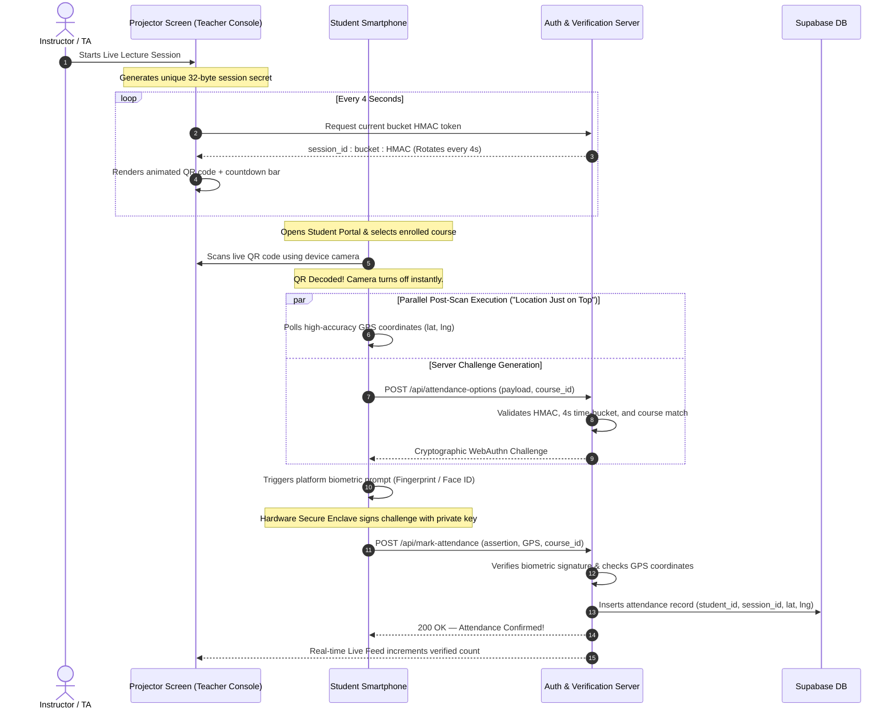

# IIT Jodhpur — Anti-Proxy Attendance Portal

> **Design Credit Project · Semester 3**<br>
> An institutional, cryptographically verified attendance portal engineered to completely eliminate proxy attendance, remote check-ins, and credential sharing in university classrooms.

---

## 📌 Executive Summary & Threat Model

Traditional university attendance methods—whether physical paper sheets, RFID cards, or static QR codes projected on lecture screens—fail routinely because credentials can easily be transferred, forwarded, or spoofed.

This portal establishes an unforgeable, zero-trust attendance pipeline by tying together four independent validation vectors:

```
┌───────────────────────────────────────────────────────────────────────────────┐
│                        ZERO-TRUST VERIFICATION STACK                          │
├───────────────────────┬───────────────────────────────────────────────────────┤
│ Vector                │ Prevents                                              │
├───────────────────────┼───────────────────────────────────────────────────────┤
│ 4-Second Dynamic QR   │ Remote screenshot sharing via WhatsApp / Telegram     │
│ WebAuthn Passkeys     │ Multi-account logins on a friend's phone              │
│ Strict Device Binding │ Burner phones, device cycling, and account trading   │
│ Parallel GPS Capture  │ Remote check-ins from hostels, cafes, or off-campus   │
│ Course-Locking        │ Accidental or intentional cross-course scans          │
└───────────────────────┴───────────────────────────────────────────────────────┘
```

---

## 🎯 How Attendance Works (End-to-End Pipeline)

Attendance verification follows a synchronous multi-phase protocol between the Instructor Console, the Student Portal, and the Server:



---

## 🚀 Key Features in Detail

### 1. The 4-Second Dynamic Rotating QR Window
- **Ephemeral HMAC Tokens**: The projector screen displays a QR code containing `session_id:bucket:hmac`. The HMAC is generated via `HMAC-SHA256` using the session's random 32-byte cryptographic secret and a Unix time bucket (`Math.floor(Date.now() / 1000 / 4)`).
- **4-Second Lifetime**: Every 4 seconds, the bucket increments, generating a completely new QR code with an animated countdown bar.
- **Why 4 Seconds?**:
  - Taking a screenshot, opening WhatsApp, sending it to an absent student in a hostel, and having them scan it from another screen requires at minimum 6 to 10 seconds.
  - A 4-second rotation window completely eliminates remote screenshot forwarding.
- **Grace Window Tolerance**: The server provides a strict `QR_GRACE_MS = 2500` grace window to account for camera optical latency and minor clock drift. If a token was scanned right as the QR code rotated, it is still accepted within 2.5 seconds. Expired codes are rejected with `HTTP 400: This QR code has expired — scan the current one.`

---

### 2. "Location Just on Top" — Parallel Post-Scan Geolocation
One major issue in mobile web apps is that polling continuous GPS coordinates in the background causes severe camera stutter, battery drain, and scanning delays.

- **Triggered If-and-Only-If Scanned**: GPS acquisition is initiated **immediately after a valid QR code is recognized by the camera**, never before.
- **Zero Scanning Lag**: Because GPS is not running while the camera is active, the camera viewfinder runs at a silky smooth 60 FPS with rapid QR detection.
- **Parallel Execution During Biometric Prompt**:
  - As soon as the QR code decodes, camera streams are stopped instantly (`safeStopScanner()`).
  - The browser requests high-accuracy GPS coordinates (`navigator.geolocation.getCurrentPosition` with `enableHighAccuracy: true`) in parallel while fetching the server challenge and waiting for the student's fingerprint prompt.
  - By the time the student completes their biometric verification (usually ~1 second), the GPS fix is already resolved. Neither action delays the other.
- **Mandatory Location Enforcement**: Both latitude and longitude are strictly enforced on the server. If location services are disabled, permission is denied, or coordinates are missing, attendance is rejected with `GPS location is required. Please turn on location/GPS on your device and try again.`

---

### 3. Hardware-Bound WebAuthn Passkeys (Biometrics)
- **FIDO2 / WebAuthn Platform Authenticators**: Utilizes device-level platform authenticators (Apple Touch ID / Face ID on iOS/macOS, Android Biometric Prompt / Keystore on Android, Windows Hello on Windows).
- **Public-Key Cryptography**:
  - During device registration, the device generates an asymmetric key pair inside its hardware Secure Enclave / TPM.
  - The public key is stored in the database (`students.webauthn_credential`), while the private key never leaves the hardware chip.
  - When marking attendance, the device signs a single-use random server challenge (`student.current_challenge`).
  - Attendance cannot be marked by sharing passwords or forwarding links; physical biometric interaction with the authorized device is mathematically required.

---

### 4. Strict Device Locking (Zero Student Self-Service Swapping)
In earlier prototypes, students could potentially use a self-service "Replace Device" button to migrate their account to a friend's phone. To preserve zero-trust integrity, this has been strictly locked down:

- **Permanent Roll Number Binding**: Once a student registers their physical phone during initial onboarding, that device's credential is permanently bound to their roll number.
- **Zero Self-Service Device Swapping**:
  - The "Replace Registered Device" button has been completely eliminated from the Student Portal.
  - Any direct attempt to re-register a device while a credential exists is hard-blocked on the server with `HTTP 409 Conflict`:
    > *"A device is already registered for this roll number. Students cannot change devices on their own. Please contact your course instructor or TA to reset your device binding."*
- **Instructor / TA Controlled Device Reset**:
  - If a student genuinely loses, breaks, or replaces their phone, only an authorized course instructor or TA can unbind the device.
  - Instructors and TAs have two entry points on their console:
    1. **Enrolled Students Table**: A dedicated `Reset Device` action button on every student row.
    2. **Manage Courses**: A standalone **"Reset Student Device"** admin card where instructors can enter any enrolled student's roll number (e.g. `B24CS1001`) to unbind their device passkey.
- **Unbind Only (No Credential Injection)**:
  - Instructors and TAs can **only unbind/remove** the existing device (`webauthn_credential: null`).
  - Teachers **cannot** create or inject new credentials on behalf of students.
  - When the student next signs in to their portal, the system detects `is_registered: false` and prompts the student to register their new phone's biometric passkey.

---

### 5. Interactive Campus GPS Verification Map
The Instructor Console features a built-in OpenStreetMap / Leaflet geolocation review tool to inspect physical check-in locations:

- **Session Date Selector**: A clean dropdown menu replaces cluttered legends, allowing teachers to select any past lecture date and view that specific session's scatter plot of check-ins.
- **Smooth Navigation**: The map features unconstrained panning, pinch-to-zoom, and mouse-wheel scrolling, with an automatic `fitBounds()` zoom to enclose all scan markers for the selected lecture.
- **Automated Campus Geofence Outlier Detection**:
  - Center of Campus: $[26.4716^\circ\text{ N}, 73.1134^\circ\text{ E}]$ (IIT Jodhpur).
  - Check-in distances are calculated using the spherical Haversine formula.
  - **Institutional Cobalt Dots (`#3b82f6`)**: Regular check-ins recorded within the campus perimeter ($\le 3\text{ km}$).
  - **Amber Alert Dots (`#f59e0b`)**: Highlighted warnings for any check-in recorded outside campus perimeter ($> 3\text{ km}$ away), indicating suspected GPS spoofing, remote submissions, or proxy attempts.
- **Interactive Marker Popups**: Clicking any dot displays the student's roll number, session date, and exact off-campus distance (e.g. `Outside campus (~4.2 km)`).
- **CSV Coordinate Export**: Instructors can export all lecture scan coordinates (Roll Number, Latitude, Longitude, Date) to CSV for department records.
- **Removal of IP Dependencies**: Stripped flaky and spoofable IP address lookups, relying purely on cryptographic device challenges and cryptographically signed location coordinates.

---

### 6. Course-Locking & Fraud Prevention
- **Strict Course Matching**: When a student opens the scanner, their selected course ID (`expected_course_id`) is locked into the session request.
- **Cross-Course Scan Prevention**: If a student in classroom A attempts to scan a QR code projected in classroom B, the server immediately rejects the request:
  > *"This QR code is for a different course. Please select the matching course from your list."*
- **Enrollment Verification**: Only students with an active record in `enrollments` for that specific course can mark attendance.
- **Duplicate Prevention**: Database unique constraint `(student_id, session_id)` prevents a student from marking attendance more than once in the same lecture.

---

### 7. Teacher Console & Academic Management
- **Class Overview & Analytics**:
  - Total lectures held count.
  - Class-average attendance percentage with dynamic SVG donut chart.
  - **Deficit Risk Tracking**: Instant tally and list of students falling below the mandatory **75% attendance threshold**.
- **Enrolled Students Directory**:
  - Search by roll number or student name.
  - Quick filter toggle (`All` vs `< 75%`).
  - Attendance fraction (e.g. `18/20`) and percentage badge.
  - **Device Status**: Displays whether the student's phone is `Bound` or `No Device`.
  - **Action Controls**: Instant `Reset Device` button and `Unenroll` button.
  - One-click CSV export of course statistics.
- **Full Attendance Sheet Matrix**:
  - Complete spreadsheet-style grid displaying all students across all lecture dates.
  - One-click manual attendance toggle (`+` override) to mark excused absences or manual verifications.
- **Teaching Assistant (TA) Delegation**:
  - Instructors can add and authorize TAs via `@iitj.ac.in` institute emails.
  - TAs inherit permissions to launch live QR sessions, review records, and unbind student devices.
- **Dedicated Manage Students Suite**:
  - Side-by-side administrative cards:
    1. **Correct Student Roll Number**: Direct tool to update roll numbers linked to student Google accounts.
    2. **Reset Student Device**: Direct roll-number lookup to unbind registered device passkeys when students replace, lose, or format their phones.

---

## 🛠️ Technology Stack

| Layer | Technology | Purpose |
|---|---|---|
| **Frontend** | Vanilla HTML5 / CSS3 / ES Modules | Lightweight, responsive, fast-loading institutional UI |
| **Mapping** | Leaflet.js & OpenStreetMap | High-performance interactive campus location visualization |
| **Camera & QR** | `html5-qrcode` | Robust, cross-platform rear-camera barcode scanning |
| **Biometrics (Client)** | `@simplewebauthn/browser` | Interfacing with Apple Touch ID/Face ID, Android Keystore, Windows Hello |
| **Biometrics (Server)** | `@simplewebauthn/server` | FIDO2 / WebAuthn Level 3 challenge generation and signature verification |
| **Backend Runtime** | Node.js Serverless Functions (`/api`, `/lib`) | Fast, stateless API routes (`api/[...route].js`) |
| **Database & Auth** | Supabase (PostgreSQL) | Relational data, Service Role Keys, and Google OAuth restricted to `@iitj.ac.in` |
| **Cryptography** | Node.js `crypto` | HMAC-SHA256 rolling tokens, timing-safe equality checks |

---

## 📂 Project Structure

```
├── api/
│   └── [...route].js           # Dynamic serverless route dispatcher
├── lib/
│   ├── attendance-options.js   # Verifies QR HMAC and issues WebAuthn challenge
│   ├── mark-attendance.js      # Verifies biometric signature & records GPS attendance
│   ├── register-options.js     # Enforces device-locking & generates registration options
│   ├── register-verify.js      # Saves platform biometric credential to student record
│   ├── teacher-reset-device.js # Instructor/TA endpoint to unbind student devices
│   ├── session-qr.js           # Generates 4-second HMAC-SHA256 rolling QR tokens
│   ├── start-session.js        # Initializes live lecture session with 32-byte secret
│   ├── end-session.js          # Finalizes and closes active lecture sessions
│   ├── course-locations.js     # Serves GPS scan coordinates for instructor map
│   ├── teacher-records.js      # Aggregates student attendance stats and device status
│   ├── config.js               # Global constants (ROTATION_SECONDS, QR_GRACE_MS, etc.)
│   ├── auth-guard.js           # Verifies student session and @iitj.ac.in domain
│   └── teacher-guard.js        # Verifies instructor/TA authorization for courses
├── index.html                  # Student Portal interface
├── attendance.js               # Student client logic (Scanner, WebAuthn, Geolocation)
├── teacher.html                # Instructor Console interface
├── teacher.js                  # Instructor client logic (QR projector, Map, Matrix, TA admin)
├── shared.js                   # Common utilities (authedFetch, toast, confirm dialogs, formatting)
├── style.css                   # Custom institutional dark-mode stylesheet
├── schema.sql                  # Database schema definitions
└── README.md                   # Project documentation
```

---

## ⚙️ Environment Configuration

To run or deploy this portal, configure the following environment variables:

| Variable | Description | Example |
|---|---|---|
| `SUPABASE_URL` | Supabase project URL | `https://xyzcompany.supabase.co` |
| `SUPABASE_SERVICE_ROLE_KEY` | Supabase service role secret key | `eyJhbGciOi...` |
| `RP_ID` | Relying Party ID for WebAuthn (domain name) | `attendance.iitj.ac.in` or `localhost` |
| `INSTITUTE_DOMAIN` | Authorized email domain for authentication | `iitj.ac.in` |
| `JWT_SECRET` | Secret key for internal signing operations | `random_32_byte_hex_string` |

---

## 🛡️ Security Guarantees & Summary

1. **No QR Forwarding**: A QR code captured on a smartphone screen expires in 4 seconds. Forwarding it to an external recipient is useless.
2. **No Multi-User Devices**: A student cannot sign into their friend's account on their phone because the friend's account is cryptographically bound to the friend's phone's biometric hardware chip.
3. **No Student Device Swapping**: Students cannot unbind or rebind their own devices. Only instructors and TAs can unbind a device.
4. **No Remote Submissions**: The student must physically be in the lecture room to capture the ephemeral QR code, and GPS coordinates are verified against the IIT Jodhpur campus geofence.
5. **No Cross-Course Proxying**: A student cannot mark attendance in Course B using a code scanned from Course A.

---

**Developed for IIT Jodhpur · Semester 3 Design Credit**
